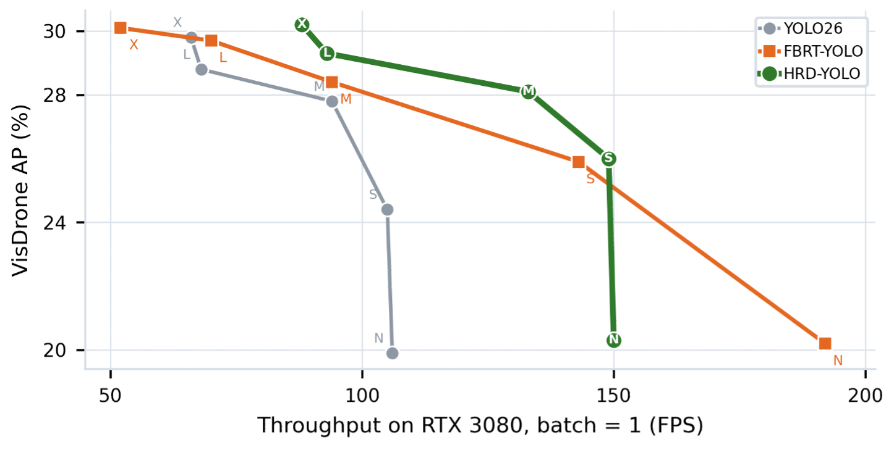
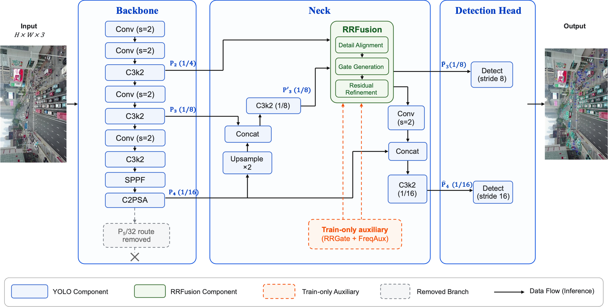
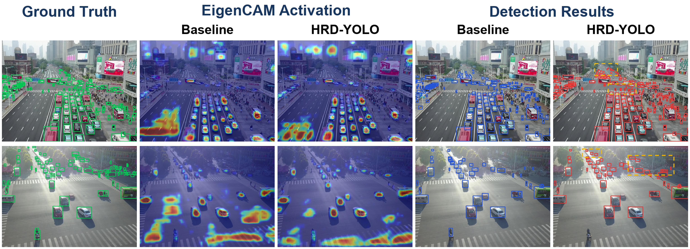

# HRD-YOLO

### High-Resolution Detail Reallocation for Real-Time Object Detection in Low-Altitude UAV Imagery

Official PyTorch implementation of **HRD-YOLO**.

<p align="center">
  
</p>

## Overview

We propose HRD-YOLO, a high-resolution detail reallocation method for real-time object detection in low-altitude UAV imagery.

<p align="center">
  
</p>

## Quick Start

```bash
# Environment Configuration
cd hrd-yolo-main
conda create -n hrd-yolo python=3.10
conda activate hrd-yolo
pip install -e .
# Training：yolo26s example
yolo detect train data=VisDrone.yaml model=yolo26s.yaml epochs=300 imgsz=640 batch=4 optimizer=MuSGD lr0=0.01 momentum=0.937 weight_decay=0.0005 device=0 
# Validation
yolo val model=/absolute/path/to/weights/best.pt data=VisDrone.yaml imgsz=640 device=0 end2end=False
```

## Yaml preparation

Data: see [VisDrone.yaml](ultralytics/cfg/datasets/VisDrone.yaml)、[UAVDT.yaml](ultralytics/cfg/datasets/UAVDT.yaml)

Model: see [ultralytics/cfg/models/26/...](ultralytics/cfg/models/26/)

## Performance

### VisDrone · Model-family comparison

Accuracy, complexity, and throughput across N/S/M/L/X scales.
**Bold metrics** mark the best listed value within each scale group; ties are included.
↑ Higher is better. ↓ Lower is better.

<table>
  <thead>
    <tr>
      <th align="left" width="205">Model</th>
      <th align="right" width="105">AP&nbsp;↑</th>
      <th align="right" width="110">AP<sub>50</sub>&nbsp;↑</th>
      <th align="right" width="145">FLOPs (G)&nbsp;↓</th>
      <th align="right" width="145">Params (M)&nbsp;↓</th>
      <th align="right" width="100">FPS&nbsp;↑</th>
    </tr>
  </thead>
  <tbody>
    <tr><th colspan="6" align="left">N-scale</th></tr>
    <tr><td align="left" height="38">YOLO26-N</td><td align="right">19.9</td><td align="right">34.5</td><td align="right">5.2</td><td align="right">2.5</td><td align="right">106</td></tr>
    <tr><td align="left" height="38">FBRT-YOLO-N</td><td align="right">20.2</td><td align="right">34.4</td><td align="right">6.7</td><td align="right">0.9</td><td align="right"><strong>192</strong></td></tr>
    <tr><td align="left" height="38"><strong>HRD-YOLO-N</strong></td><td align="right"><strong>20.3</strong></td><td align="right"><strong>35.4</strong></td><td align="right"><strong>4.2</strong></td><td align="right"><strong>0.7</strong></td><td align="right">150</td></tr>
    <tr><th colspan="6" align="left">S-scale</th></tr>
    <tr><td align="left" height="38">YOLO26-S</td><td align="right">24.4</td><td align="right">41.1</td><td align="right">20.5</td><td align="right">9.9</td><td align="right">105</td></tr>
    <tr><td align="left" height="38">FBRT-YOLO-S</td><td align="right">25.9</td><td align="right">42.4</td><td align="right">22.9</td><td align="right"><strong>2.9</strong></td><td align="right">143</td></tr>
    <tr><td align="left" height="38"><strong>HRD-YOLO-S</strong></td><td align="right"><strong>26.0</strong></td><td align="right"><strong>43.2</strong></td><td align="right"><strong>16.5</strong></td><td align="right"><strong>2.9</strong></td><td align="right"><strong>149</strong></td></tr>
    <tr><th colspan="6" align="left">M-scale</th></tr>
    <tr><td align="left" height="38">YOLO26-M</td><td align="right">27.8</td><td align="right">45.9</td><td align="right">67.9</td><td align="right">21.8</td><td align="right">94</td></tr>
    <tr><td align="left" height="38">FBRT-YOLO-M</td><td align="right"><strong>28.4</strong></td><td align="right">45.9</td><td align="right"><strong>58.7</strong></td><td align="right"><strong>7.2</strong></td><td align="right">94</td></tr>
    <tr><td align="left" height="38"><strong>HRD-YOLO-M</strong></td><td align="right">28.1</td><td align="right"><strong>46.6</strong></td><td align="right">66.5</td><td align="right">11.5</td><td align="right"><strong>133</strong></td></tr>
    <tr><th colspan="6" align="left">L-scale</th></tr>
    <tr><td align="left" height="38">YOLO26-L</td><td align="right">28.8</td><td align="right">47.3</td><td align="right">86.1</td><td align="right">26.2</td><td align="right">68</td></tr>
    <tr><td align="left" height="38">FBRT-YOLO-L</td><td align="right"><strong>29.7</strong></td><td align="right">47.7</td><td align="right">119.2</td><td align="right">14.6</td><td align="right">70</td></tr>
    <tr><td align="left" height="38"><strong>HRD-YOLO-L</strong></td><td align="right">29.3</td><td align="right"><strong>47.9</strong></td><td align="right"><strong>82.4</strong></td><td align="right"><strong>14.2</strong></td><td align="right"><strong>93</strong></td></tr>
    <tr><th colspan="6" align="left">X-scale</th></tr>
    <tr><td align="left" height="38">YOLO26-X</td><td align="right">29.8</td><td align="right">48.7</td><td align="right">193.4</td><td align="right">58.8</td><td align="right">66</td></tr>
    <tr><td align="left" height="38">FBRT-YOLO-X</td><td align="right">30.1</td><td align="right">48.4</td><td align="right">185.8</td><td align="right"><strong>22.8</strong></td><td align="right">52</td></tr>
    <tr><td align="left" height="38"><strong>HRD-YOLO-X</strong></td><td align="right"><strong>30.2</strong></td><td align="right"><strong>49.0</strong></td><td align="right"><strong>185.0</strong></td><td align="right">31.8</td><td align="right"><strong>88</strong></td></tr>
  </tbody>
</table>

### VisDrone · Representative detectors

**Bold metrics** mark the best listed value in each column. — indicates an unreported value.

<table>
  <thead>
    <tr>
      <th align="left" width="270">Method</th>
      <th align="right" width="145">AP&nbsp;↑</th>
      <th align="right" width="145">AP<sub>50</sub>&nbsp;↑</th>
      <th align="right" width="145">AP<sub>75</sub>&nbsp;↑</th>
    </tr>
  </thead>
  <tbody>
    <tr><td align="left" height="38">DMNet</td><td align="right">29.4</td><td align="right">49.3</td><td align="right">30.6</td></tr>
    <tr><td align="left" height="38">QueryDet</td><td align="right">28.3</td><td align="right">48.1</td><td align="right">28.8</td></tr>
    <tr><td align="left" height="38">CEASC</td><td align="right">28.7</td><td align="right">50.7</td><td align="right">28.4</td></tr>
    <tr><td align="left" height="38">YOLC-R50</td><td align="right">28.9</td><td align="right"><strong>51.4</strong></td><td align="right">28.3</td></tr>
    <tr><td align="left" height="38">FBRT-YOLO-X</td><td align="right">30.1</td><td align="right">48.4</td><td align="right"><strong>31.7</strong></td></tr>
    <tr><td align="left" height="38">UAV-DETR-R18</td><td align="right">29.8</td><td align="right">48.8</td><td align="right">—</td></tr>
    <tr><td align="left" height="38"><strong>HRD-YOLO-X</strong></td><td align="right"><strong>30.2</strong></td><td align="right">49.0</td><td align="right">30.9</td></tr>
  </tbody>
</table>

### UAVDT · Detection accuracy

**Bold metrics** mark the best listed value in each column. — indicates an unreported value.

<table>
  <thead>
    <tr>
      <th align="left" width="270">Method</th>
      <th align="right" width="145">AP&nbsp;↑</th>
      <th align="right" width="145">AP<sub>50</sub>&nbsp;↑</th>
      <th align="right" width="145">AP<sub>75</sub>&nbsp;↑</th>
    </tr>
  </thead>
  <tbody>
    <tr><td align="left" height="38">ClusDet</td><td align="right">13.7</td><td align="right">26.5</td><td align="right">12.5</td></tr>
    <tr><td align="left" height="38">GLSAN</td><td align="right">17.0</td><td align="right">28.1</td><td align="right">18.8</td></tr>
    <tr><td align="left" height="38">DREN</td><td align="right">15.1</td><td align="right">—</td><td align="right">—</td></tr>
    <tr><td align="left" height="38">GFL</td><td align="right">16.9</td><td align="right">29.5</td><td align="right">17.9</td></tr>
    <tr><td align="left" height="38">CEASC</td><td align="right">17.1</td><td align="right">30.9</td><td align="right">17.8</td></tr>
    <tr><td align="left" height="38">FBRT-YOLO-X</td><td align="right">18.4</td><td align="right">31.1</td><td align="right">18.9</td></tr>
    <tr><td align="left" height="38">YOLO26-X</td><td align="right">21.6</td><td align="right">33.8</td><td align="right">24.4</td></tr>
    <tr><td align="left" height="38"><strong>HRD-YOLO-X</strong></td><td align="right"><strong>23.0</strong></td><td align="right"><strong>35.5</strong></td><td align="right"><strong>25.6</strong></td></tr>
  </tbody>
</table>

### HRD-YOLO-S · Progressive ablation

Configurations follow the original progressive sequence.
**Bold accuracy values** highlight the final configuration.

<table>
  <thead>
    <tr>
      <th align="left" width="250">Configuration</th>
      <th align="right" width="90">AP&nbsp;↑</th>
      <th align="right" width="95">AP<sub>50</sub>&nbsp;↑</th>
      <th align="right" width="95">AP<sub>75</sub>&nbsp;↑</th>
      <th align="right" width="145">FLOPs (G)&nbsp;↓</th>
      <th align="right" width="135">Params (M)&nbsp;↓</th>
    </tr>
  </thead>
  <tbody>
    <tr><td align="left" height="38">YOLO26-S</td><td align="right">24.392</td><td align="right">41.139</td><td align="right">24.482</td><td align="right">20.5</td><td align="right">9.9</td></tr>
    <tr><td align="left" height="38">+ P<sub>5</sub> removal</td><td align="right">24.603</td><td align="right">41.289</td><td align="right">24.882</td><td align="right">14.8</td><td align="right">2.7</td></tr>
    <tr><td align="left" height="38">+ Direct injection</td><td align="right">24.907</td><td align="right">42.272</td><td align="right">25.053</td><td align="right">15.9</td><td align="right">2.8</td></tr>
    <tr><td align="left" height="38">+ Main gate</td><td align="right">25.123</td><td align="right">42.219</td><td align="right">25.462</td><td align="right">16.5</td><td align="right">2.9</td></tr>
    <tr><td align="left" height="38">+ RRGate</td><td align="right">25.326</td><td align="right">42.770</td><td align="right">25.349</td><td align="right">16.5</td><td align="right">2.9</td></tr>
    <tr><td align="left" height="38">+ FreqAux (zero cues)</td><td align="right">25.873</td><td align="right">43.080</td><td align="right">26.115</td><td align="right">16.5</td><td align="right">2.9</td></tr>
    <tr><td align="left" height="38"><strong>HRD-YOLO-S (Full)</strong></td><td align="right"><strong>25.997</strong></td><td align="right"><strong>43.174</strong></td><td align="right"><strong>26.450</strong></td><td align="right">16.5</td><td align="right">2.9</td></tr>
  </tbody>
</table>

### Visualization

<p align="center">
  
</p>

## Acknowledgement

The code base is built with [ultralytics](https://github.com/ultralytics/ultralytics).

Thanks for the great implementations!
